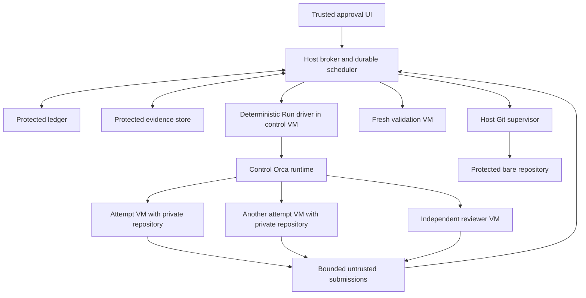

# Orca-Flow Orchestration Framework

Orca Flow coordinates parallel implementation, review and local integration across chat and controller restarts on a native host. A deterministic broker owns authorization, scheduling, durable state and protected Git operations. A deterministic Orca driver owns each native Run. Model agents propose plans and produce work in separate execution guests.

The approved scope is autonomous implementation, testing, review and integration into a protected local integration branch. Publishing or changing protected main requires fresh approval for the exact action. Live missions must make deterministic progress without worker messages or a coordinator model turn. Codex, Claude Code and Antigravity are candidate harnesses. Additional physical hosts remain later scope; connected Orca runtimes between local isolated VMs are an early architectural dependency. No service, VM, credential or runtime configuration is installed by this design.

## Foundation

The Orca CLI executable must be confirmed available, running and reachable outside any tool sandbox. The controller must distinguish executable action errors and never restart Orca to solve, for example, an access denial.

## Assumptions

| Assumption | Checked Conclusion | Design Consequence |
| --- | --- | --- |
| Append `--json` everywhere | Operational commands support it, but `--help --json` still prints text; `skills get --json` has a different envelope from runtime commands. | Require JSON for machine operations; maintain separate, explicitly typed discovery parsers. |
| Ready means started | The startup observer distinguishes observed, permission, unsupported, and unobserved states. Concise startup output can exit zero for an unobserved turn. | Read full startup receipts and preserve uncertainty. |
| Worktrees eliminate merge conflicts | They isolate working directories; separately authored changes can still conflict when integrated. | One checkout per parallel writer; scratch clones separated from protected Git storage; conditional candidate integration. |
| A child worktree inherits its parent’s Git base | Parentage controls sidebar organization. Git base is a separate choice. | Record and verify the actual starting commit. |
| A monitor can poll `check` harmlessly | Plain `check` consumes mail. Its flags and batch semantics matter. | The genuinely bound deterministic Run driver is the only consumer; dashboards and model advisers never consume. |
| A Run schedules tasks | A Run supplies a namespace and coordinator inbox. | The framework owns scheduling policy and capacity. |
| A lost response means the command failed | `request-show` can report completed, pending, or absent; absent is not proof of no effects. | Reconcile before retrying any mutation. |
| Session restoration proves work continued | UI/runtime restart and machine reboot have different process outcomes. | Reconcile assignment identity, liveness, Git state, and evidence after every recovery. |
| Current web documentation matches the installation | Online guidance permits remote child worktrees; installed 1.4.251 help refuses them. | Version and capability checks precede feature use. |

The second checks are the release’s [CLI specifications](https://github.com/stablyai/orca/blob/a162e08b29b2883b02d8a0dfcc99e26c80b2cfe7/src/cli/specs/orchestration.ts), [worker command specifications](https://github.com/stablyai/orca/blob/a162e08b29b2883b02d8a0dfcc99e26c80b2cfe7/src/cli/specs/orchestration-worker-specs.ts), [startup observer](https://github.com/stablyai/orca/blob/a162e08b29b2883b02d8a0dfcc99e26c80b2cfe7/src/main/runtime/rpc/methods/orchestration/worker/worker-start-turn-observation.ts), [startup output adapter](https://github.com/stablyai/orca/blob/a162e08b29b2883b02d8a0dfcc99e26c80b2cfe7/src/cli/handlers/orchestration/worker-start-agent-view.ts), and [mutation recovery tests](https://github.com/stablyai/orca/blob/a162e08b29b2883b02d8a0dfcc99e26c80b2cfe7/src/main/runtime/rpc/orchestration-mutation-request-show.test.ts). Worktree ancestry and shared-directory behavior are documented in [Worktrees](https://www.onorca.dev/docs/model/worktrees). Process survival distinctions are documented in [Session restore](https://www.onorca.dev/docs/model/session-restore).

Additional checks were performed on the installed help for `terminal create`, `worktree create`, `check`, `inbox`, `worker-stop` and `worker-release`, and the bundled placement guide. The pinned [terminal identity resolver](https://github.com/stablyai/orca/blob/a162e08b29b2883b02d8a0dfcc99e26c80b2cfe7/src/cli/handlers/orchestration/terminal-identity.ts) accepts genuine terminal identity, and [Run creation](https://github.com/stablyai/orca/blob/a162e08b29b2883b02d8a0dfcc99e26c80b2cfe7/src/main/runtime/orchestration/db/runs/run-create.ts) stores that binding without a model-type predicate. This supports a shell-based driver design, but does not qualify its complete live lifecycle. Installed remote placement uses `--on` and an exact existing remote workspace or `new-top-level`; remote `new-child` is refused in this baseline.

## Architecture and Ownership

Use the package name `orca-flow`. Commands beginning `orca-flow` are proposed interfaces, not existing Orca commands. Implement policy and state machines in TypeScript with a pinned Node runtime, a cross-platform-tested SQLite binding and JSON Schema validation. Use a small native  supervisor for process/job operations that Node cannot express safely.



A mission has one approved mandate, one active plan revision, one native Orca Run, one deterministic driver binding and a protected accepted integration ref. Missions share the broker's global capacity ledger. The control VM hosts trusted framework code and Orca only: no model agent, target repository, repository hooks, setup, build or test code runs there. Each model attempt, including planning and review, gets a separate VM, runtime profile and independent scratch Git repository. A validation job receives another fresh VM without a model agent. VMs may share a read-only sealed OS image; they never share writable Git administration data or writable build outputs.

The deterministic driver is the native coordinator. It starts inside its own genuine Orca-managed terminal, binds the mission Run and owns its consuming mailbox calls. It invokes only broker-admitted typed effects and reports exact receipts. A model previously called the coordinator becomes a planning adviser with worker-level proposal authority. It cannot consume the Run inbox, obtain driver credentials, change policy or delay routine release by being rate-limited. One driver terminal owns one Run; `run-use` is not a multi-Run tab switch.

| Component | Authority and responsibility |
| --- | --- |
| Host broker | Mandates, plans, epochs, budgets, admissions, resource claims and acceptance. |
| Durable scheduler | Timers, reconciliation work, bounded fixed-point cycles and continuation scheduling. |
| Native Run driver | Actual Run binding, mailbox ingestion, pre-admitted CLI lifecycle calls and receipt capture. |
| Planning adviser | Untrusted plan/decision proposals within the mission packet. |
| Worker or reviewer | Only its own input downloads, submissions, questions and bounded status access. |
| Evidence service | Immutable byte storage, provenance, publication pins and integrity checks. |
| VM supervisor | Fixed bootstrap, attestation, retirement and observed containment state. |
| Validation launcher | Fixed admitted check jobs, source identity and result capture. |
| Git supervisor | One-shot protected Git execution and kernel process-tree settlement. |
| Approval service | User verification and exact authority/action grants; never delegated to models. |

Orca remains the source of native assignment and routing observations. Git records content. Only the host broker can accept content or change protected policy. A compromised worker runtime may lie about its own assignment; that cannot prove acceptance, free capacity or affect another attempt. No component edits Orca's database.

Local VM placement uses Orca's connected-runtime worker protocol: the Run stays on the control runtime, and `worker-start --on` targets an exact workspace in the attempt VM. Pairing must expose no general control-runtime RPC or sibling mailbox authority to an execution VM. A constrained authenticated relay, if the native protocol needs one, must bind every message to its admitted Dispatch and VM generation. Proving this route, genuine shell ownership and cross-platform guest harness support is Increment 0 work. If the installed transport requires unrestricted reverse access, admission remains disabled until the adapter/protocol is corrected and qualified. Same-user co-location is not a fallback.

## Restricted Execution Boundary

The threat model includes arbitrary agent commands and repository-controlled hooks, dependencies, setup, builds and tests. It excludes compromise of the host administrator, VM host, trusted broker/control binaries or identity provider. Separation must hold even when a worker ignores its task instructions.

The host broker runs under a dedicated service identity. Only trusted host components can write the ledger, evidence, credentials, approval records and protected bare repositories. The control VM is isolated from execution VMs. Each attempt VM has separate runtime credentials and scratch storage. Reviewer VMs never reuse the author's writable disk, runtime, Git config or process state. No hardlinks, Git alternates, writable host mounts, shared `.git`, host clipboard/drive redirection, host process launch or publishing credentials connect these domains. A branch named main in a worker's scratch clone is untrusted scratch data, not a protected destination. [Git worktrees share ordinary refs](https://git-scm.com/docs/git-worktree#_refs), so worktree separation alone cannot implement these boundaries.

Derive broker capabilities from authenticated channels and server-side bindings, not caller-supplied role, SID or mission fields. Driver capabilities permit only admitted effects for its mission/epoch. Worker capabilities permit download of that attempt's frozen inputs, bounded uploads, own-attempt status and questions. Validation and VM-control channels are distinct. Agent clients on the host remain proposal/status clients; they cannot assert human authority merely because they run under the user's SID. A host agent with administrator or publisher credentials is outside the qualified deployment.

Native pairing credentials are held in the control plane. Execution VMs may expose their own scoped runtime endpoint to the control VM, but receive no credential that authorizes central task creation, inbox consumption, sibling completion or policy changes. Authenticate and validate incoming federation events at the control boundary. Treat native remote receipts as observations; correlate them with the admitted Dispatch and independently observed VM identity. Deliberately exercise forged IDs, replay, direct central CLI/RPC, sibling mailbox reads and hostile runtime replies in qualification.

A host-controlled network policy and restrictive proxy allow only qualified model-provider operations and approved input/package services. Block Git push, hosting write APIs, host management, arbitrary proxying and indirect publication through provider-side tools, connectors or authenticated browsers. Qualify each harness's complete tool surface with dedicated least-privilege credentials. There is no unrestricted alternate route when a required extension cannot be constrained. Per-VM resource limits and provider limits complement scheduling; they do not establish an exact count of hidden model calls by malicious code.

Before repository code starts, install the isolation profile, mint attempt-scoped access, import frozen inputs, create the Orca workspace with setup skipped and no agent, and verify its actual commit/tree. Disable configured automatic tabs/hooks during this bootstrap; qualify that `--setup skip` plus the sanitized runtime profile really prevents early code execution. Only then may the driver launch the worker on the existing workspace. Repository setup, if required, is an explicitly admitted execution-stage job in that same attempt boundary, never privileged bootstrap code.

The host-to-guest adapter exposes fixed operations with typed IDs and signed manifests: provision, bootstrap, query, retire, export submission and launch an admitted validation job. PowerShell Direct can carry these fixed bootstrap operations but cannot manufacture an Orca caller identity. Never accept arbitrary command text, host paths, credentials or executable choices from a model. Provisioning, licensed (if necessary) VM images, VM host availability, guest Orca support, network controls and harness behavior are mandatory qualification inputs, not installed protections.

## Durable State and Concurrency

Keep authoritative SQLite state, evidence, approved policy, credentials, and protected repositories under a broker-owned host directory with ACLs that exclude execution guests and agent identities. The user-facing path is an installation setting; placing files outside a checkout alone is not a security boundary. Use a supported local volume, migrations, foreign keys, durable transactions, and qualified backups. Credentials must never be included in task snapshots, evidence exports, or repository configuration copied to guests.

| Record | Required fields |
| --- | --- |
| Mission and revision | Mission/Run IDs, repository identity, approved objective, active plan revision/hash, policy revision, accepted integration commit, status. |
| Driver binding | Genuine terminal identity, control runtime/incarnation, consumer generation, broker epoch, work/ack versions and last reconciliation. |
| Execution environment | VM ID, image/profile digest, boot generation, attempt/job binding, credential epoch, lifecycle and observed retirement proof. |
| Task revision | Logical ID, phase, immutable spec hash, typed predicates, resolved input candidate IDs, mapped native Task IDs. |
| Deliverable and candidate | Deliverable ID, current candidate ID, generation, exact commit/tree, review verdict, supersedes link, accepted integration result. |
| Attempt and ticket | Task revision, Dispatch ID, launch ticket/epoch, requested/effective settings, start evidence, settlement and retry ancestry. |
| Command and action journal | Operation ID, canonical arguments, cwd/identity, expected effects, raw receipts, request ID, outcome, related approval where required. |
| Message receipt | Runtime location, Run/message/Delivery IDs, payload digest, durable ingestion/processing state. |
| Evidence and checks | Content-addressed immutable chunks, provenance class, producing attempt/check job, exact tested content/environment, retention pins. |
| Decision and reserved approval | Distinct record types; ordinary scope/answer versus authenticated principal, exact action digest and expected destination. |
| Resource claim | Canonical resource key, owning attempt/job, claim type, release evidence, unmanaged occupancy if taken over. |
| Timer and notification | Due time/reason, target mission/epoch, state version, outbox status, attempt/backoff, reconciliation acknowledgment. |

Use normalized tables and an append-only audit journal in `ledger.sqlite`. Store artifact bytes in a separate `evidence.sqlite`; the ledger holds small manifests, digests, provenance and publication references. Git objects are separately pinned. Neither SQLite databases, Git nor Orca are assumed to commit atomically together. The evidence publication and backup protocol below bridges those stores explicitly.

Enforce uniqueness for each native Dispatch/message within its runtime location and one unsettled attempt per task revision. Reserve launch intent, resources and VM binding in one broker transaction. Every starting, live, blocked, kept-open or uncertain attempt holds its compute reservation. Product disposition, native terminal retention, VM compute and disk retention are independent dimensions. Completion immediately queues deterministic retirement; a review need not wait for the author's disk to be deleted.

The broker owns mutation serialization and epochs. Transactions contain no CLI, network, VM host, model or build waits. Long effects are journaled jobs under persistent claims. Ledger writes target one second on qualified hardware; five seconds without progress triggers a degraded-storage admission hold, not an assertion of rollback. Bounded evidence transactions have their own queue and health measurements. Cancelling a stuck database call or replaying its mutation is not a recovery strategy. See the explicit health recovery states below.

Global admission is transactional across missions. Canonical repository keys use the broker registry UUID plus the resolved Git common-directory identity; on host, record volume/file identity and resolved junction targets rather than lowercasing a display path. Ref keys add the fully qualified refname. External keys include the actual endpoint, tenant and resource. Ambiguous aliases or unavailable identity probes block admission. Resource release and actionable decisions increment a scheduling work version and append reconciliation work for affected waiting missions in the same transaction.

## Task and Attempt Lifecycles

Keep three different dimensions: Orca’s reported task/dispatch state, the framework’s assessment of attempt execution, and acceptance of the resulting artifact. A successful `worker_done` may settle an Orca Task before review or integration has passed.

Execution: `Planned → Materializing → Launching → Running/StartUncertain/WaitingPermission → Reported/Failed/StopUnknown`.

Product: `Reported → StructurallyValid → InReview → CandidateAccepted → IntegrationCandidate → Integrated`. Review rejection, integration conflict or combined-check failure leads to `RemediationRequired → InReview` when the shared remediation budget permits; otherwise `NeedsDecision`. These states do not own worker compute.

Compute: `Reserved → ActiveOrUncertain → ReleasingCompute → ComputeReleased`, with `ReleasePending`, `ReleaseUnknown` and `ManualTakeover` branches that retain occupancy. Disk/evidence retention is a separate lifecycle.

The diagram shows the normal path. Failed, cancelled, paused, and recovery-required conditions are explicit additional states. Do not coerce an unknown startup into failed, or an unresolved cancellation into cancelled.

| Observation | Framework treatment |
| --- | --- |
| `turnStart: observed`, or a validated `turn_started` stage | Record running with the associated Dispatch and evidence time. |
| `turnStart: permission` | Agent is handling input but requires permission; classify waiting permission. |
| `turnStart: unsupported` | Record accepted without start observation. Wait for an authenticated worker checkpoint or completion. |
| `turnStart: unobserved`, `outcome_unknown`, or lost launch receipt | Preserve resources and enter startup reconciliation. Never resend solely because a deadline expired. |
| `turnStart: queued` | Work is queued behind another turn. Do not start the execution timer or send it again. |
| Worker `status` with `phase: started` and correct assignment | Supplement start evidence; it does not grant completion authority. |
| Accepted success report before any start observation | Advance directly to reported; do not invent a start timestamp. |
| CLI wait keepalive on stderr | Evidence that the CLI wait is alive, not that its worker progressed. |

Runtime startup handling permits a completion arriving during observation to settle the assignment; the adapter must tolerate this ordering. See the release’s [startup settlement implementation](https://github.com/stablyai/orca/blob/a162e08b29b2883b02d8a0dfcc99e26c80b2cfe7/src/main/runtime/rpc/methods/orchestration/worker/worker-start-readiness-settlement.ts).

Separate timeout classes: CLI transport, checkout/setup, turn observation, time since meaningful progress, execution budget, and user decision wait. Timeouts change diagnosis or dispatch eligibility; they do not prove process death. After machine sleep, record the observation gap before judging inactivity. Store UTC timestamps and durations; display local times in Australia/Brisbane.

On any terminal execution report, persist the submitted artifacts and their manifest, then queue guarded release immediately. A structurally invalid or absent report does not justify keeping an idle worker forever: retain recoverable disk/transcript evidence and retire it as failed according to the mandate. The retirement pipeline is:

1. Inspect the exact Dispatch and ownership. Request `worker-release` for settled owned workers, or `worker-stop` for cancellation/unfinished work. Journal the native outcome, including retained, release_pending and release_unknown; exit zero is not proof of release.
2. Seal received artifacts or record what is missing. Request attempt-VM retirement. Revoke guest credentials and provider routes, prohibit restart/resume of that VM generation, and observe the VM in Off state through the trusted VM host. Saved, paused, stopping and an accepted stop request are insufficient.
3. After the VM host has proved the old execution environment cannot run, release its compute lane transactionally and notify all capacity waiters. A stale native record may remain `native_cleanup_pending`; it does not outweigh proven VM retirement. Never reuse the original runtime/VM generation or resume its memory image.
4. Retain the powered-off disk, transcript and evidence under storage claims. Later inspection uses a new admitted analysis environment; cleanup cannot silently restart old agent memory or credentials.

The initial mission mandate explicitly authorizes retirement of framework-owned attempts after report/cancel/abandon, with a configurable graceful interval (default 30 seconds). VM retirement handles unknown native stops without killing other attempts. If the VM host status cannot prove Off or credential/launch fencing is incomplete, keep occupancy and surface a containment fault. User-kept-open/manual-takeover sessions are excluded from automatic retirement unless separately authorized; their capacity remains visible. No arbitrary terminal-close fallback may replace Orca's guarded release.

## Planning and Scheduling

Every task specification includes the objective, inputs and their hashes, allowed edits, explicit exclusions, dependency artifacts, expected base commit, required checks, wrong-but-plausible failure cases, report location, and escalation rules. The user’s approved scope remains attached to the plan revision.

Compile a deliverable into implementation, review, remediation where needed, and integration steps with typed dependency predicates. Review consumes a structurally valid reported candidate; integration consumes that exact candidate’s acceptance; a code consumer requires its accepted integration result. Mirror only monotonic prerequisites into native Orca dependencies. The broker evaluates all richer predicates against the active plan/candidate generation before issuing a launch ticket.

A review that ran successfully and found defects reports successful completion of the review assignment with a separate rejected product verdict. Failure to perform the review is a failed assignment. Remediation creates a distinct task linked to a rejected candidate; its output becomes a new candidate and needs a new review. A startup failure remains a retry on the same native Task with its original retry ancestry. These relationships never erase history or reset the startup breaker.

Eligibility requires every declared typed predicate, a current plan/candidate generation, no unresolved gate, a qualified harness/boundary, available resources, and remaining budget. Order candidates by explicit priority, critical-path need, queue age, and stable ID. Timers, backoff expiry, decisions, and released global resources trigger reevaluation even when the waiting mission has no workers.

Start with three admitted worker lanes across the machine, plus explicit control-plane and validation resources. All live/uncertain lanes remain reserved across blocked states. Per-account, memory, validation-job, setup and repository limits are separate. The limit describes framework-admitted sessions; guest CPU/RAM limits constrain processes but do not prove that a noncompliant agent created no hidden model call. On manual takeover, stop autonomous lifecycle control, retain its occupancy against available capacity until exit/suspension is proven, and record any explicitly configured unmanaged usage. Never silently free the slot.

Codex maps to Orca `codex`, Claude Code to `claude`, and the user-facing alias `agy` maps to `antigravity`. Do not pass `--agent agy` without a locally verified alias. Harness selection is configuration, not a claim that a particular model is inherently best at a role. Record model and effort only when the user or approved project policy chooses them; otherwise inherit the harness configuration and inspect the effective launch receipt. Test each harness’s permissions, startup, question/reply, completion, and session resume behavior before admitting it to production scheduling.

The default product-remediation budget is one cycle per deliverable, shared across review rejection, integration conflict and combined-check failure. It funds one semantic remediation assignment and a new independent review. A later semantic failure after that cycle requires a user decision. The counter persists across restarts and plan revisions. A mission-wide refresh has its own explicit one-cycle semantic budget and cannot reset any deliverable counter. A failed review execution consumes its own retry budget, not a product remediation cycle. Expanding scope, weakening policy or increasing a budget requires authenticated authority; deterministic revisions already covered by the mandate are recorded without another user ceremony; it cannot silently reset native retry breakers. Provider usage that cannot be measured remains unknown; a hard monetary cap requires qualified enforcement.

Infrastructure retries are separate: stale integration bases and proven settled no-application outcomes may create a fresh integration operation, with default three rebuild retries before `NeedsDecision`. Native startup retries retain Orca ancestry and its breaker. Neither new operation IDs nor plan revisions reset any budget. All VM memory, CPU and disk reservations are checked before provisioning; three worker lanes is a cap, not a promise that three guests fit on the machine.

## Deliverables and Plan Revision Protocol

Task execution and product disposition are separate. A review can execute successfully and reject a candidate. A failed review process has no product verdict. Never infer acceptance from an Orca Task's succeeded state.

| Predicate | Meaning and permitted consumer |
| --- | --- |
| report_ready | The producing attempt settled with a complete published report; a report processor may inspect it. |
| structurally_valid | Identity, spec, commit and required report structure match; review may start. This is not product acceptance. |
| candidate_accepted | Required review/check evidence accepts the exact current candidate generation under the active policy; integration may prepare it. |
| integrated | The exact accepted candidate is recorded in a successfully promoted integration result with intact evidence; dependent implementation may consume that result. |

For example, implementation I produces candidate C0. Review V0 completes successfully with verdict reject. Remediation R starts from C0 and the findings, producing C1 with `supersedes: C0`. The broker atomically changes the deliverable's current candidate to C1, invalidates C0's prospective acceptance and prepares V1 against C1. V1's acceptance permits integration of C1. Consumer C becomes eligible only after that promotion, with a frozen input manifest naming C1 and its integration result. It never consumes a mutable reference to “I's latest output.” Historical C0 and its review remain auditable. If V1 rejects, the default one-cycle product budget is exhausted and the deliverable awaits replanning.

Plan activation is a compare-and-swap transaction against the active revision. If a protected promotion/action is already admitted and unresolved, defer conflicting plan/policy activation, candidate-generation replacement, evidence invalidation and integration-source changes until its outcome is reconciled. An urgent invalidation records a hold immediately and blocks acceptance; it cannot pretend to undo an admitted external effect. A persistent exclusion claim serializes this boundary without holding a database transaction across Git or network I/O; cancellation intent can still be recorded. Validate the proposed DAG, specification hashes, typed predicates, frozen inputs, candidate mappings and cumulative budgets first. In one transaction activate the revision, invalidate affected eligibility, supersede pending task revisions, and append cancellation/reconciliation intents and notifications. Already admitted jobs retain their original immutable inputs and capacity. Their later reports are historical unless explicitly adopted through fresh validation under the new revision. No old completion can automatically satisfy a new candidate or task.

Native Task dependencies represent only stable monotonic prerequisites supported by the installed API. Materialize new native Tasks for replacement task revisions; do not pretend mutable dependency rewiring is supported. Native task creation can fail after plan activation, so journal it as an asynchronous materialization effect and keep affected work ineligible until its exact mappings are reconciled. A plan revision never resets retry or remediation history. Replanning that raises a user-owned cap is an ordinary authenticated policy decision; publishing approvals remain a separate, stronger action-specific channel.

## CLI Adapter Contract

Resolve and fingerprint Orca separately for the control and execution runtimes. Pin version/capabilities, executable and installed guide hashes; capture sanitized raw command fixtures. The known host executable is a discovery baseline, not a guest path assumption. Unknown required semantics freeze affected mutations.

Invoke binaries with argument arrays, `shell: false`, separate stdout/stderr and hidden helper windows. Require `--json` on operations and `--full` on supported orchestration receipts. Parse the complete JSON document, including JSON on a nonzero exit. Transport failure, parse failure, `ok: false`, retained/pending and outcome_unknown are different states. Help is a text discovery parser even with `--json`; `skills get` uses its own envelope. Preserve stderr keepalives without interpreting them as worker progress.

Use `--spec-file` for multiline instructions. Supply `--deps` as one JSON-array argument. Preserve exact returned Run/Task/Dispatch/environment/worktree IDs. Never reconstruct identities from titles or execute suggested command text from a receipt. `ORCA_EXE` below means the pinned executable; placeholders are not runnable configuration.

```text
ORCA_EXE status --json
ORCA_EXE skills get orchestration --json
ORCA_EXE terminal create --worktree <trusted-control-workspace> --title <driver-title> --command <fixed-driver-bootstrap> --shell powershell.exe --json
ORCA_EXE orchestration run-create --objective <objective-with-mission-id> --json --full
ORCA_EXE orchestration run-use --id <existing-run> --json --full
ORCA_EXE orchestration task-create --run <run> --task-title <title> --spec-file <path> --deps <json-array> --json --full
ORCA_EXE worktree create --environment <attempt-environment> --repo <exact-guest-repo> --name <name> --no-parent --base-branch <bootstrap-ref> --setup skip --json
ORCA_EXE orchestration worker-start --run <run> --task <task> --on <attempt-environment> --worktree <exact-existing-workspace> --agent codex --json --full
ORCA_EXE orchestration worker-show --dispatch <dispatch> --json --full
ORCA_EXE orchestration worker-read --dispatch <dispatch> --source auto --limit 50 --json --full
ORCA_EXE orchestration worker-list --run <run> --include-remote --json --full
ORCA_EXE orchestration worker-stop --dispatch <dispatch> --json --full
ORCA_EXE orchestration worker-release --dispatch <dispatch> --json --full
ORCA_EXE orchestration request-show --request <returned-request-id> --json --full
ORCA_EXE orchestration check --run <run> --json --full
ORCA_EXE orchestration check --run <run> --peek --json --full
ORCA_EXE orchestration check --run <run> --all --json --full
ORCA_EXE orchestration inbox --terminal run:<run> --limit <bounded-limit> --json --full
```

`terminal create` runs only the installed fixed driver bootstrap, with a broker-generated mission identifier; no repository text enters its command string. The driver then uses its own inherited identity to create/bind the Run. PowerShell Direct may request that terminal creation through the control runtime; it never impersonates the terminal. There is no model in that terminal. Live qualification must establish this ownership through restart and mailbox consumption.

The input-sync/bootstrap step creates a private guest repository and a pinned bootstrap ref before `worktree create`. No untrusted process can modify it during bootstrap. Verify the created workspace's actual head/tree and sanitized configuration before the first agent or setup job. `worker-start` on an existing workspace receives no creation-only `--setup`, `--name` or `--base-branch` flags. `new-child` is not valid remote placement in the pinned release and is not used for cross-VM work. Bind every admitted effect to the environment ID, authenticated peer identity and VM generation; do not repoint an old environment alias at a replacement guest while an old command can still complete. Aliases map `agy` to `antigravity`, Claude Code to `claude` and Codex to `codex`.

`worker-release` is the guarded settled-session operation. It does not promise to close reused, configured, setup, user-kept or unproven terminals. Interpret its exact domain result and reconcile remote attachment cleanup. Do not rely on an optional automatic-release delay. `worker-stop` requests stopping an assignment; stop_unknown is not death. VM retirement provides the independently enforced compute-release boundary.

Plain `check` consumes a FIFO batch. Only the bound driver calls it; dashboards use non-consuming forms. `--all` means recent retained messages, not an unlimited audit log. `inbox --full` preserves complete payloads; raise its bounded limit only within qualified caps and detect retention gaps. Exact keyed recovery uses the original `--retry-request`; it is not a caller-invented universal idempotency key. Retired orchestration scheduler commands are unsupported.

## Wake processing and message recovery

The durable scheduler and native driver perform bounded reconciliation until quiescent. Maintain separate `audit_version`, `work_version` and `ack_work_version`: receipts/observations that can change eligibility increment work_version; logging, delivery bookkeeping and acknowledgment alone do not. Resource release, decision answers, due timers and activated plans enqueue durable reconciliation in the same ledger transaction.

1. Claim a mission cycle under the current driver/broker epoch. Import a native batch or recover its prior command receipt. Commit the exact batch before another consuming check.
2. Reconcile observations, artifacts, jobs, native mappings, deadlines, pending releases and ambiguous effects. Evaluate only active revision/candidate bindings.
3. Admit bounded independent effects transactionally. Execute outside the ledger transaction and record each result. An unknown effect blocks its dependent chain; it does not cause a second launch or stop unrelated cleanup.
4. Repeat reconciliation/admission after each newly recorded result. Task materialization, object synchronization and worker launch are separate steps: recording `task-create` is not the end of the cycle if it enables input sync or `worker-start`.
5. In a final broker transaction, acknowledge only the version actually evaluated and only if it still equals current work_version and no runnable effect, unprocessed observation, pending due job or continuation remains. Future timers and genuinely blocked tasks may be quiescent. A raced update makes the comparison fail and leaves work pending.
6. A cycle ends after the configurable budget (default 32 admissions or 2 seconds of scheduler CPU/wall work, excluding asynchronous job waits). If immediate work remains, persist a continuation due within five seconds without acknowledging quiescence. Fair scheduling prevents one mission's loop from starving others.

No transaction waits for a CLI job. A pending asynchronous operation records its next observation deadline before the driver yields. An event arriving after a successful quiescence acknowledgment increments work_version and recreates pending work in its own transaction. This closes the acknowledgment race without notifications caused solely by acknowledgment itself.

Mail is at-least-once observation across Orca and the broker. Deduplicate native IDs within runtime location and preserve payload digests. Recover the consuming-check/persist crash window through exact retry receipts, retained inbox history and Task/Dispatch observations. Never infer exactly-once delivery from two independent stores. If required history was pruned, hold only dependent actions for resolution; do not fabricate message identities. Native text and worker questions cannot become approval records.

## Live Mission Progress Protocol

The host service polls due reconciliation work at most every five seconds while the host is awake and healthy. Target deterministic deadline diagnosis and admission eligibility within thirty seconds, measured under a qualified workload. CLI, boot, setup, model and check completion have separate timeouts; no fixed total completion latency is promised. Sleep records an observation gap and triggers an overdue scan on wake.

The driver is a persistent non-model process in its real Orca terminal. It polls `pollWork(mission, epoch, cursor)` on the authenticated broker channel, records receipts through `recordEffectReceipt`, and submits guarded `ackQuiescent` or `scheduleContinuation`. The host never needs to inject a wake prompt into an LLM to release resources, inspect assignments or launch already-approved tasks. Planning-model failure blocks only work that actually needs a new plan or semantic decision. Existing review/implementation effects, retirement and unrelated missions continue when their other preconditions hold.

Core scheduling no longer requires a notifier sending messages to its own Run. If an optional operator/model notification bridge is installed, it runs in its own genuine Orca terminal with a delivery-only capability. Its APIs are `pollNotifications` and `recordNotificationDelivery`. States are `pending → sending → delivered_to_inbox → reconciled/superseded`, with `delivery_unknown` requiring receipt/history inspection. Successful send suppresses ordinary resend until reconciliation; a busy recipient receives no repeated wake. A configurable slow poke, default five minutes, may send one coalesced newest-version reminder when the recipient is not active. Unknown activity is treated as active for resend suppression. No five-second mailbox resend loop is permitted.

The optional bridge uses `ORCA_EXE orchestration send --to run:<run-id> --type status --subject <fixed-subject> --body <bounded-notification-json> --json --full`. Payloads contain only IDs, epoch/version and reason. Delivery to Orca and acknowledgment by the driver are distinct records. Optional notification failure does not freeze the core scheduler. Driver/channel failure marks the affected mission degraded while the host still manages containment and other missions.

Service recovery may restart deterministic helpers under their fixed installed configuration. A replacement driver must fence the previous process, use a new genuine terminal if necessary, bind the existing Run and reconcile native consumer generation and unsettled effects before admissions. Never copy caller identity. Automatic mission admission after host reboot remains disabled in release one; explicit resume applies the same reconciliation protocol. No model turn is needed for any of these deterministic steps.

## Restart and Ambiguous Mutation Recovery

Persist a command intent before starting its CLI subprocess. Persist raw output and the returned request ID as soon as available, then normalize the receipt transactionally. A local operation UUID correlates the journal; it is not an Orca idempotency key. The installed contract reserves `--retry-request` for exact recovery using the original request identity, so do not invent and reuse it as a universal first-call deduplication flag.

| Observed situation | Required response |
| --- | --- |
| Command explicitly proves no effects were applied | Correct the precondition; record a new authorized operation. |
| Lost response, request receipt completed | Read the recorded outcome; reconcile its entities before any next action. |
| Request pending and original CLI still running | Continue observing that command; do not launch another. |
| Request pending and original command ended | Follow supported keyed recovery with exactly the same command, caller context, and parameters. |
| Request absent or request ID unavailable | Inspect existing Run/Task/Dispatch/workspace state. Absence is inconclusive; never blind-replay a mutation. |
| Caller/runtime identity changed | Re-establish the legitimate binding and check replay compatibility. If incompatible, reconcile effects rather than pretending to be the old caller. |
| CLI timeout after input acceptance | Mark the launch uncertain, preserve its reservation, and await authoritative state. |

Include the mission ID, logical task ID, specification revision, and local operation ID in creation metadata/specification to help find ambiguous results. They are correlation markers, not server-enforced uniqueness. If two candidates match or none can be proven, stop dependent mutations and surface the ambiguity. This is the deliberate limit of automation where atomic commit across Orca and the framework is unavailable.

`resume` verifies both protected stores, the mandate, all VM generations and the control boundary, then inventories the recorded Run, unsettled Dispatches, timers, questions, input exports, workspaces, protected refs and unfinished jobs/actions. Preserve surviving workers and reservations. Reuse the surviving genuine driver or fence it and bind a replacement to the existing Run, checking consumer generation before new admissions. Resume pending sync, retirement and integration successors from durable state; never revive an old VM memory snapshot or execution token. Reconcile all overdue work before launching new tasks.

Do not call `run-create` to simulate resume. Do not use `--takeover-legacy` for ordinary current Runs. Also, `run-use` unbinds the caller’s other Runs; it is not a harmless tab switch. The release [binding implementation](https://github.com/stablyai/orca/blob/a162e08b29b2883b02d8a0dfcc99e26c80b2cfe7/src/main/runtime/orchestration/db/runs/run-binding.ts) increments consumer generations when ownership changes, and its [restart and handoff test](https://github.com/stablyai/orca/blob/a162e08b29b2883b02d8a0dfcc99e26c80b2cfe7/src/main/runtime/orchestration-cli-restart-handoff.test.ts) exercises retained work and mail through a simulated runtime restart. That test does not prove every real harness survives a host reboot.

The handover packet contains the objective and authorization boundary, plan/policy hashes, Run and task mappings, acceptance state, active and uncertain attempts, pending decisions, durable timers/outbox, current deliverable generations, retained resource claims, latest evidence, exact repository/base/integration commits, unresolved command intents, remaining budgets, and the next safe action. Keep transcript links for investigation; do not make full conversation history a prerequisite for recovery.

## Workspaces and Integration

Every attempt VM has an independent scratch repository. Private ports, databases, output directories, package caches and temporary paths are part of its resource declaration. Inspect Orca shared-path/configured-tab settings during bootstrap; a new checkout alone does not establish independence. No execution VM can access a protected host Git common directory.

### Frozen Input Export and Synchronization

Resolve the exact accepted integration result or reported review candidate before dispatch. The broker pins its commit/tree closure and creates an export manifest containing mission, task revision, attempt/VM generation, purpose, object format, exact required OIDs, bundle byte digest, byte size and retention pin. Export is a journaled read-only Git job; cache its actual bytes. Git pack encoding need not be byte-identical when regenerated, so a new export receives its own digest even for the same commit.

Provide `prepareInputExport` and authenticated `downloadInputExport` endpoints scoped to the admitted attempt. The default is a standalone bundle with the required object closure. A thin/incremental bundle is allowed only when its prerequisites were attested for that exact guest generation. [Git bundle verification](https://git-scm.com/docs/git-bundle) checks prerequisites and format; it is additional to byte-digest and exact-content checks. Large repositories use a separately configured bounded input-transfer quota; the report artifact cap does not silently truncate repository input. LFS objects, submodules and external inputs need explicit frozen manifests/adapters or the task is refused.

The trusted guest bootstrap downloads bytes, verifies the manifest/digest, imports into an otherwise empty private repository with hooks/filters and external helpers disabled, resolves the required commit/tree and performs connectivity checks. It establishes a bootstrap ref and uses Orca to create the workspace with setup skipped. It then reports `input_ready` for that exact workspace, commit/tree, profile and VM generation. A launch ticket requires this receipt; absent objects, changed manifests, wrong tree, failed transfer or old VM receipts keep the task in `InputSyncPending/Failed`. Retry reads by content identity without launching an agent. All checks precede untrusted code. Later worker mutations are untrusted output, not proof that the initial receipt was false.

Uploads follow the reverse quarantine path: bounded bytes, no caller-selected host path, restricted parser/import, exact commit/tree verification, and protected pins before acceptance. Guest scratch refs and report OIDs never directly authorize host ref updates. Fresh downstream workers synchronize the accepted promoted result, including new integration commits that never existed in their predecessor's clone.

### Candidate Integration and Successors

1. Prepare K from accepted head H0, exact ordered source commits, current deliverable generations, strategy, checks and input pins. Create a private candidate checkout in an isolated preparation/validation VM. No command during preparation targets the protected destination.
2. Apply the frozen source range. A conflict settles K as `conflict_failed`; a combined-check failure settles it as `validation_failed`. Capture evidence and release eligible preparation claims. No agent runs inside K or the validation guest to repair it.
3. For semantic failure, create a distinct remediation task from the current accepted head plus the preserved failure/candidate manifest. Consume the deliverable's shared semantic remediation cycle. The replacement is a new candidate generation, independently reviewed and checked before a new integration K'. Exhaustion leads to `NeedsDecision`, not a terminal dead end or hidden infinite retries.
4. If preparation succeeds, freeze C/tree and run required combined checks under `trusted_launch` on exact content. Import the resulting commit and complete evidence into protected stores. Admit promotion only while plan/policy/generations, evidence and expected H0 still match.
5. Promote using the unchanged single-destination journal protocol below. Reconcile the original writer and actual destination, commit acceptance in the ledger, then unblock consumers. Missing markers never cause replay.

| K outcome | Product disposition and next action |
| --- | --- |
| `committed` | Integrated with exact result ID and provenance; release eligible claims. |
| `stale_base` before issuing | Retain candidate acceptance; reconcile prior operation, release its eligible claims and schedule K' against the current accepted head. |
| `not_applied_observed` after settled writer | Retire consumed K permanently; for ordinary local integration, schedule a separately admitted K' after verifying the current protected head. |
| `conflict_failed` or `validation_failed` | RemediationRequired, then new candidate/review within the shared semantic budget; otherwise NeedsDecision. |
| `cancelled` before effects | No successor unless current approved intent still requests one. |
| `recovery_hold` or uncertain writer | Retain exclusion and occupancy; no successor until the hold is legitimately resolved. |

Infrastructure successors do not consume semantic remediation, but use the bounded rebuild budget. They retain ancestry and cannot overlap an unresolved predecessor. A new K' prepares afresh from the current head; never reapply a partially prepared range to the accepted ref. A failed reserved action always needs a newly prepared action and fresh approval; the ordinary-integration retry rule does not authorize publication retry.

### Mission Integration Refresh and Publication Source

`action prepare` names a mission and exact committed integration-result ID, not a single pre-integration deliverable candidate. The result contains the accumulated mission content, source commit/tree, contributing candidates and validation/policy digests.

If target main advances to T and the mission integration source S is not a descendant of T, do not force publication. Start a separately journaled mission refresh M with frozen S, T and the complete contributing-deliverable manifest. In an isolated preparation guest, create a merge candidate C that retains S and T, or apply the explicitly approved deterministic refresh strategy. Run combined checks and an independent review of the changed integration result. Conflicts or semantic changes require a distinct refresh-remediation worker and new review under the mission refresh budget. Preserve all prior deliverable evidence and identify what must be revalidated.

After acceptance, conditionally promote the mission's local integration ref from S to C using its own K. Then prepare a fresh reserved action whose source is C and expected target is T. A further target advance invalidates that action; refresh/reprepare again within the bounded rebuild budget. Neither refresh nor a prior approval authorizes updating main. Targets checked out in a protected human worktree are refused; synchronizing a human checkout is a separate workflow.

## Protected ref Publication and Recovery

Select Git’s files ref backend for release one and record the actual backend, object format, Git executable/version, local NTFS/storage settings and repository identity in the qualification profile. Refuse unqualified backend/configuration drift. Preparation checks and locks ref preconditions; publication is performed per ref. A successful command reports completion of its requested updates, while concurrent visibility and crash/storage durability are separate properties. Neither nonzero exit nor absent marker proves no effect. The [Git update-ref contract](https://git-scm.com/docs/git-update-ref#_description), the [v2.56.0 files-backend commit loop](https://github.com/git/git/blob/v2.56.0/refs/files-backend.c#L3110), and the reproduced commit-phase fault establish why recovery cannot assume an indivisible destination/marker pair.

New operations write exactly one protected destination ref. Keep operation history and completion in the protected SQLite journal; do not create a Git recovery-marker ref. Read legacy markers only as corroborating or contradictory evidence. Object pins used for retention are separate preparatory effects and are verified before admission; their presence is not proof of promotion. This removes the second ref from the publication protocol without claiming that SQLite and Git commit together.

### Journal and Writer Protocol

Before issuing Git, persist operation K with repository/ref identity, expected H0, candidate C and tree, frozen plan/policy/candidate generations, published evidence digests, original execution epoch, object pins and the exclusive writer claim. Require H0 and C to differ; an equal-head operation is a separately recorded no-op with no Git subprocess. Ref creation represents H0 as explicit absence and uses the object-format-appropriate zero OID.

The executor atomically changes a one-shot execution token from unissued to consumed before it can create the Git subprocess; reserved actions consume the bound approval in that same transaction. Recheck expiry, revocation and frozen admission constraints at that transition; a cancellation/revocation recorded before consumption prevents launch. Only the winner of this transition may launch. A crash between consumption and process creation may waste an execution token, which is preferable to permitting duplicate execution. No resume path starts an already consumed token. Revoke/cancel admission races serialize at that boundary.

Launch a direct argument-array command equivalent to `git update-ref --no-deref <destination> <C> <H0>`, with pinned executable/configuration, hooks disabled and no repository-controlled programs. Reject symbolic destinations before launch and exclude writers that could replace them. If the adapter uses stdin, supply explicit LF-delimited bytes; host text-mode newline translation previously caused command rejection. Pin the actual Git executable rather than assuming a PATH launcher is the writer; the host interruption probe did not interrupt publication until it targeted the resolved backend executable. Capture process identity/creation evidence and raw exit/output independently from effect state.

The broker is the only permitted protected writer. Its persistent exclusion claim covers the whole operation, including a crash after Git publication and before SQLite reconciliation. Plan/policy activation, candidate supersession/invalidation, maintenance, restore and manual repair must use the same gate. An emergency integrity invalidation holds acceptance immediately; it cannot retroactively stop a ref mutation already admitted. Recheck that hold before recording acceptance.

On recovery, prevent the former executor from launching or resuming work, then prove the original Git process and all possible writer descendants have exited or been terminated through a qualified host supervisor. Use the host supervisor contract below; missing root PID alone is insufficient, but a qualified empty/destroyed job with all spawners fenced can establish settlement after restart. A lease expiry, missing PID, lost IPC, stale lockfile or another controller’s new epoch is insufficient. Retain claims while liveness is uncertain. A settled-process proof, intact journal, continuous exclusive-writer history and healthy qualified storage form the recovery preconditions. Confirm object/evidence integrity and the frozen admission constraints before reading destination D. Do not clear Git lockfiles by age; qualified cleanup requires settled-writer evidence and exact ownership.

### Host Writer Supervision

Run protected Git through a dedicated deterministic host supervisor, independent of the broker process. The fixed action vocabulary excludes repository code, external helpers, WMI/service-mediated process creation and unqualified child launch paths. Pin the actual Git backend executable and sanitized configuration. A Job Object is process-tree supervision for this trusted executor, not a sandbox for hostile repository code.

Before consumption, persist a unique operation/job name, supervisor identity, repository claim and executable/configuration digests. Create the named Job Object with a service-only DACL, `KILL_ON_JOB_CLOSE`, neither breakaway flag, and no inherited job handle. Establish that it is a newly created object, not an existing name. The supervisor alone may spawn into it.

The supervisor obtains the durable one-shot consumption transition before creating any Git process. Only that successful, unambiguous transition authorizes launch. A lost consume response means inspect/retire, never guess and spawn. Create the process suspended with the job supplied at creation; verify assignment, then persist PID and process creation time before resuming. Failure at any step terminates/settles the job and never returns the token to unissued. Creation-time assignment removes the crash gap of creating an uncontained suspended process and assigning it later.

Record `{supervisorInstanceId, supervisorPID, supervisorCreationTime, jobName, processPID, processCreationTime, bootObservation}`. PID fields may be absent if the crash preceded their journal update; the pre-recorded job identity still covers that window. `bootObservation` is diagnostic unless an authoritative reboot proof is separately qualified; a changed clock or LastBootUpTime value alone is not used as a release predicate in v1.

On recovery, first seal further spawns/resumes for K. A surviving supervisor acknowledges this only after draining any in-progress create/resume call. Otherwise prove the old supervisor process identity has exited and prevent its restart from replaying consumed K. Then one of these establishes settled writer:

| Observation | Settlement rule |
| --- | --- |
| Named job opens and queried active-process count is zero | Settled after spawn/resume fencing; retain process exit evidence when available. |
| Named job contains processes | Observe or request job termination, then query again until empty; keep the exclusion meanwhile. |
| Job name is positively absent in the qualified namespace | Settled only with intact job-creation/containment protocol, fenced old spawners, no escaped descendants and a specific object-not-found result. |
| Access denied, query failure, namespace mismatch, missing root PID only, kill request accepted, or lost completion-port event | Unknown; retain the hold. |

Microsoft documents job lifetime through associated-process termination and last-handle closure; ordinary completion notifications are not guaranteed. Therefore neither a kill-on-close request nor one notification is the settlement barrier. Query the job or prove qualified object destruction. Child creation outside the job protocol is forbidden. Qualify object-name absence, nested-job restrictions, crash-before-PID, surviving child, recycled PID, access denial and broker/supervisor restart with real host processes before enabling protected writes. After proven settlement, ref/ledger reconciliation remains mandatory; process death says nothing about whether Git already advanced the destination.

### Recovery Decision Table

Rows describe an expected operation K with H0 different from C. “Marker” means the legacy marker for K, not any unrelated ref. First apply the hold overrides below; then evaluate the table. Read failures and malformed refs are not absence.

| Durable journal for K | Destination D | Legacy marker | Recovery result |
| --- | --- | --- | --- |
| Missing, corrupt or mismatched intent/consumption | Any | Any | recovery_hold; reconstruct from protected audit evidence or obtain authenticated operator resolution. A marker cannot authorize an operation. |
| Prepared; proven unissued and old executor fenced | H0 | Absent | Cancel/retire the unissued intent without a Git effect; normal new admission is a separate operation. |
| Prepared/unissued | C, other or unreadable | Any | recovery_hold: external state contradicts the journal. |
| Issuing; token consumed | C | Absent or C | Record applied_observed, including nonzero/lost response; commit acceptance only after integrity checks. No Git mutation or marker repair is needed. |
| Issuing; token consumed | H0 | Absent | Record not_applied_observed and retire the token. This describes current state, not proof the ref was never transiently changed. A further attempt is a new admission; a reserved action needs fresh approval. |
| Issuing; token consumed | H0 | C | recovery_hold: apparent partial/rolled-back state contradicts the current destination. |
| Issuing; token consumed | Other or unreadable | Any | recovery_hold; do not overwrite, reset or reapply source commits. |
| Any | Any | Conflicting, malformed or unreadable | recovery_hold until the inconsistency is resolved; a broken marker path is diagnostic, not no-effect evidence. |
| Applied/committed record | C | Absent or C | Preserve consumption and verify the recorded acceptance; acknowledgment may be repeated without another Git call. |
| not_applied_observed record | H0 | Absent | Preserve the terminal record and consumption; do not relaunch K. |
| Any remaining inconsistent combination | Any | Any | recovery_hold with claims and evidence retained. |

Overrides take precedence: a live/unknown writer, lost exclusion continuity, unqualified storage/backend, missing validation evidence, changed candidate/admission constraints or invalid reserved-action consumption prevents automatic acceptance and claim release. Restored snapshots require the restoration protocol and cannot use head equality as causal proof. A known later operation may legitimately move D beyond C only after K was durably reconciled; verify that complete journal chain instead of misclassifying a completed predecessor as an unsettled operation.

For issued D=C with no marker, causal attribution to K is justified only by the qualified exclusive-writer history and intact pre-effect intent. Otherwise record that the desired state was observed and retain recovery_hold; equal content alone does not prove who wrote it. Local automatic recovery makes no claim for concurrent outside writers or unqualified power-loss/storage behavior. These are supported degraded outcomes requiring diagnosis or authenticated resolution, not grounds for silent retry.

Resolution is a final SQLite transaction that records observations, immutable evidence links, K’s result and acceptance/hold, preserves the consumed execution/approval tombstones, and releases eligible claims only with a settled writer and a resolved result. A database failure before this transaction commits leaves the old intent and claims active. Repeating this reconciliation is idempotent and never invokes Git. Cleanup and object collection occur only after the committed resolution. Ordinary integration and local main promotion use this identical protocol; remote publication retains its separately qualified endpoint and unknown-response rules.

## Worker Contract and Acceptance

Workers inherit Orca’s injected assignment preamble and a framework task packet. They must verify the expected repository/base, report a start checkpoint, keep edits within scope, use `ask` for coordinator questions, and return a structured report before sending completion. They must not schedule helpers outside the framework’s capacity accounting. Nested delegation is disabled in the first release unless explicitly modeled and admitted.

A worker report contains mission/task/plan revision, deliverable/candidate generation, native Task/Dispatch IDs, assignment outcome, product verdict where applicable, base/head/tree, dirty state, changed paths, criteria, submitted artifact digests and claimed check results. It is an untrusted submission. The broker ingests exact bytes and supplies its own provenance/validation records; a worker cannot label itself trusted. Failed workers report retained changes and blockers.

Workers send `worker_done` once logically, with the injected Task and Dispatch IDs and explicit succeeded/failed outcome. If the response is lost, recover that same send through Orca’s receipt protocol; do not create a second logical completion or switch IDs. The coordinator verifies that Orca accepted the lifecycle signal and that the report matches the assigned task/revision. A status message, a final paragraph saying “done,” or an idle terminal cannot settle work.

The validator checks schema, identity, current revision/candidate generation, submitted bytes, scope, and exact content. Worker-provided logs establish only what was claimed. Required combined checks and tests designated critical by policy run under a trusted launcher in an isolated environment with captured command, tool/image/dependency hashes, inputs, exit status, timestamps and raw output. The launcher is trusted; repository-controlled test code remains untrusted and receives no host privilege. Do not claim that even a genuinely executed passing test proves a complete specification. Reuse prior attested checks only when their recorded validity inputs still match.

The reviewer receives the requirement and exact diff independently, with named failure cases and acceptance criteria. Reviewer agreement alone is not a sufficient acceptance rule. Findings must identify an observable defect, violated criterion, or meaningful missing check. A reviewer must not quietly modify the implementation while presenting the result as independent review.

## Evidence Publication and Backup

Store immutable artifact bytes in `evidence.sqlite`; `ledger.sqlite` stores small manifests, provenance, publication references and acceptance. Use a supported local volume and qualified SQLite versions, durability settings and backup APIs. Require the upstream WAL-reset fix: SQLite documents it in 3.51.3 and later, with qualified backports including 3.50.7. The disposable probe used Python's SQLite 3.50.4 and is not a production-version endorsement. WAL still has one writer per database and does not make transactions across attached databases atomic. This separation reduces ledger contention; a shared physical disk can still stall both stores. See [SQLite WAL](https://www.sqlite.org/wal.html).

Default artifact limits remain 64 MiB per artifact and 256 MiB per attempt. Stream bounded 256 KiB chunks in independent evidence transactions through a backpressured queue. Verify whole-object digest, chunk sequence, byte count and completeness before setting evidence `Ready`. Exact bytes and provenance are immutable; changed content becomes a new identity. Large repository-input exports use their separate admitted transfer quota. Missing required logs cannot be silently truncated into complete proof.

The cross-store publication protocol is deliberately asymmetric:

1. Journal a publication intent in the ledger with its immutable artifact identity and producing attempt/job. Stage and verify chunks in the evidence store; no acceptance references staging.
2. Commit the complete Ready manifest and a durable publication pin in evidence.sqlite. Pins do not expire merely because time passes or the broker crashes.
3. In a later ledger transaction, publish the evidence reference only after checking that Ready manifest/pin and matching digest. Acceptance may then reference published evidence, active revisions and protected Git pins. Failure leaves either an unpublished upload or an orphan pinned object, never valid acceptance of absent bytes.
4. Recovery checks both stores and resumes publication by identity. Missing/corrupt evidence behind a ledger reference places all dependent acceptance/effects on integrity hold. Re-uploading identical bytes does not manufacture missing trusted-launch provenance.

Garbage collection and publication share a broker barrier. GC may remove an orphan pin only after proving no ledger reference, pending publication intent, backup pin or in-flight publisher can acquire it. It never removes pins by lease age. Retention transfers/releases are journaled idempotently; crash-safe leakage is preferable to deleting evidence that a ledger might reference. Validate reference integrity during recovery and before protected acceptance/action admission.

Storage health states are `Healthy → DegradedAdmissionHold → Draining → IntegrityChecking → Healthy/RecoveryHold`. A watchdog stops new effects but does not cancel a possibly committing SQLite writer. Observe its definitive result, drain bounded queues, check database/integrity and cross-store references, reconcile in-flight Git/Orca effects, then complete read/write probes and measured latency checks before clearing the hold. Repeated stalls reduce ingestion concurrency or require operator/storage repair. Never clear the hold solely because five seconds elapsed or a late commit returned. Existing workers remain accounted for while the ledger is unavailable.

Reports retain `worker_claim` provenance. Policy-critical checks require a separately captured `trusted_launch` record: admitted check ID, exact source/tree, image/tool/dependency hashes, launcher identity, output manifests, exit/timeout/cancel result and timestamps. Trust comes from the channel and job binding, not a field in an uploaded JSON report. Passing a genuine test does not prove specification completeness.

A complete backup enters a broker-wide checkpoint barrier: stop new effects, settle or explicitly hold existing writers, drain publication/GC, pin all referenced evidence and Git closures, and capture consistent snapshots of both databases plus the matching protected ref map. It records database digests, schema/profile identities, lineage, operation/consumption high-water marks, claims and pins. Copy pinned immutable content after capture. A backup with unresolved effects is recovery-only, not automatically runnable. [SQLite backup](https://sqlite.org/backup.html) is a per-database snapshot mechanism; the broker supplies the cross-store barrier.

Restore invalidates outstanding approvals, fences old launch paths and compares actual Git/external destinations before admission. An old backup cannot prove that no later effect occurred; reconstruct from protected later audit evidence or require authenticated resolution. Preserve consumed-token tombstones, even for unknown effects. Missing evidence, unmatched store/ref checkpoints or missing later history impose a hold. Do not recreate refs or replay actions from marker absence. Portable exports exclude secrets.

### Validation Guest Provisioning and Trusted Launch

Maintain a versioned, patched, sealed and powered-off host validation image. Each job uses a new differencing disk and new VM identity/credential epoch. Optionally keep a bounded pool of clean prebooted instances that have never run repository code; retire every used instance. Do not restore arbitrary running memory snapshots with old keys or processes. For Windows hosts, Hyper-V checkpoints are not backups and do not establish a seconds-long boot guarantee. See [Hyper-V checkpoints](https://learn.microsoft.com/en-us/windows-server/virtualization/hyper-v/checkpoints).

The host adapter implements `provisionValidation(imageDigest, resources)`, `prepareInputs(job, manifest)`, `trustedLaunch(jobId, admittedCheckConfigDigest)`, `readJobOutput(jobId, cursor)`, `queryJob(jobId)`, `cancelJob(jobId)` and `retireValidation(vmGeneration)`. These are fixed typed verbs, not arbitrary host/guest shell escape hatches. The installed guest launcher validates the signed job binding and starts the configured command under a separate low-privilege job account. Repository code cannot alter the launcher, its credential or capture channel. Only approved check definitions select executables/arguments; model-generated shell text is never executed with launcher privileges.

Attest image/profile and exact input commit/tree before launch, capture results outside the untrusted process, and verify unexpected source changes afterward. Use a separate private output directory; an expected build output cannot disguise an altered input tree. Revocation and observed VM Off complete retirement. Resource reservations include validation VM memory/disk/CPU and remain held through uncertainty. Qualification measures cold/warm start and cleanup times; the scheduler uses those measurements rather than an assumed fast checkpoint reset.

## Decisions and Authorization

Every authority-changing operation has a broker-validated grant. A host SID, logged-in desktop, agent-submitted `authority=user`, or host CLI invocation cannot create one. The trusted approval UI uses a qualified fresh user-verifying WebAuthn ceremony bound to a displayed canonical digest, nonce, relying party/origin, expiry and authenticated principal. Enrollment is a trusted administrative operation. Protect against scripted confirmation and replay; do not export a reusable human-session bearer token into agent-accessible storage or processes.

The user approves a mission mandate containing objective/plan hash, edit scope, required checks, policy, resource/budget ceilings, permitted deterministic plan transformations, retry rules, cleanup/VM-retirement authority and decision classes that may be delegated. The mandate excludes publishing and protected-main changes. The broker can activate deterministic task materialization/remediation revisions already permitted by this mandate, and answer explicitly delegated ordinary decisions, without repeated user ceremonies. Those are policy evaluations against the grant, not agent claims of consent.

Starting a new mission, broadening scope, removing required checks, changing protection/network profiles, increasing budgets, changing reserved targets or answering a user-escalated decision requires a fresh digest-bound approval. Resume within an unrevoked mandate may be deterministic after reconciliation; it cannot expand that mandate. A model may submit proposals or request the approval UI, but only the trusted ceremony creates authority. `decision answer` accepts a predelegated decision capability or a specific approved answer digest; it never turns arbitrary free text into human authorization. Ambiguity resolution uses the same trusted channel.

Reserved publication/main actions always require their own fresh exact-action user verification, even within an approved mission. The mission mandate is not reusable publication approval. [WebAuthn](https://www.w3.org/TR/webauthn-3/) supplies ceremony and verification primitives; the binding and policy rules here are application requirements to qualify.

Prepare reserved actions as immutable records containing action ID/type, mission, policy/plan revision, canonical repository and destination identity, transport/endpoint configuration digest, source SHA or artifact digest, expected destination SHA (or explicit absence), exact prepared result SHA/tree, approved ref set, evidence digest, nonce and expiry. Hash the complete action object using SHA-256 over [RFC 8785 JCS](https://www.rfc-editor.org/rfc/rfc8785) bytes; reject duplicate keys and unsupported values before hashing. Bind the authenticated approval to this digest. The executor verifies that approval is unrevoked, unexpired and unused, then atomically journals the exact action, creates its exclusion claim, and binds the approval to its one-shot execution record. Immediately before spawning the executor, durably mark the execution token and approval consumed. Consumption survives failure, lost response, absent marker and subsequent reconciliation; it is never changed back to unused. Revoke and execute serialize on the same action record: revocation wins before execution admission; after effects may have begun, record revocation_requested and reconcile rather than promising rollback.

Local main promotion uses the same journal, one-shot consumption and single-destination conditional-update protocol as integration. It must support destination C with no marker without another main mutation or another use of the approval. A separately admitted retry of a reserved action requires fresh approval. For v1 remote publication, support only a single named Git ref with an explicit expected old OID, an exact source commit, a pinned approved endpoint and a tested server. Enforce a fast-forward policy separately; use explicit `--force-with-lease=<ref>:<expected>` only to impose the old-OID precondition, never to permit unapproved history rewriting. Ref creation requires expected absence. Never infer the expected OID from a moving remote-tracking branch. Other publishing APIs, PR creation, release uploads and provider-side merge methods remain unsupported until an adapter qualifies conditional/idempotent semantics. These are separate actions, never implied by a Git-push approval. See the [Git push precondition contract](https://git-scm.com/docs/git-push).

After a lost action response, query the exact destination and operation/provider evidence. Expected result present can confirm the desired state, but cannot by itself prove which actor caused it; record that distinction. A mismatched or unknowable result remains unresolved. Never automatically repeat an uncertain remote effect merely because the current ref again equals its original value: another actor may have advanced and reset it. Resolve that case through provider evidence or an authenticated operator decision and, if necessary, a new approval. Source/endpoint/policy changes or a failed destination precondition require a new prepared action and approval.

The protected action executor is a fixed host component with a narrow action vocabulary. It does not run agent-supplied shell commands, repository hooks, builds or tests. Credentials and protected refs are unavailable to every model agent, including planning advisers. The execution boundary is installed before any guest setup or repository code runs. If any harness, extension, network route or bridge can bypass it, that harness is refused autonomous admission; policy-only disclosure is no longer an allowed fallback.

## Failure Handling and Retention

| Condition | Default action |
| --- | --- |
| Runtime access denied | Fix command permissions; preserve running Orca. |
| Runtime unavailable | Inspect/start the selected runtime when appropriate; reconcile before resuming mutations. |
| Worker silent or startup unobserved | The timer service triggers bounded diagnosis; preserve uncertainty and resources. |
| Proven failed/stopped attempt, safe retry allowed | Retry the same Task, with `--retry-of` and explicit placement/agent choices. |
| Worker reports semantic failure | Preserve evidence; retry/replan within the task’s semantic budget. |
| Rate limit or provider outage | Pause affected admissions and persist a backoff timer; its expiry notifies waiting missions. Never switch identity or provider silently. |
| `stop_unknown` | Record cancellation requested but unconfirmed; inspect exact assignment and retain claims. |
| Intentional abandonment | Under the mandate, fence the assignment and retire its attempt VM; retain compute until Off and access/launch revocation are observed. |
| Release pending/unknown | Follow guarded lifecycle recovery; never replace it with broad terminal close. |
| Manual user takeover | Reconcile ownership, preserve the session, stop autonomous lifecycle control, and retain unmanaged capacity occupancy until exit or enforceable suspension. |
| Missing/corrupt required evidence | Suspend acceptance-dependent effects; preserve historical records with an integrity hold and rebuild evidence only through a valid check. |
| Driver channel unavailable | Degrade the affected mission; retain work and continue independent host containment/other missions. Optional notification failure does not gate scheduling. |
| Storage full or ledger write failure | Stop issuing new mutations; existing workers may continue, so reconcile them after storage recovery. |

The installed recovery guide circuit-breaks a chain after three failed starts; a worker’s failed report is a different counter. Preserve this breaker across sessions. Do not evade it with a new Task, Run, or reset. Reopening after the breaker requires the explicit user-directed procedure on the same Task. See [Orca recovery and cleanup](https://github.com/stablyai/orca/blob/a162e08b29b2883b02d8a0dfcc99e26c80b2cfe7/skill-guides/orchestration/references/recovery-and-cleanup.md).

Pause stops admissions while timer/reconciliation services continue. Cancel records intent immediately, then requests guarded stop of owned jobs/agents; confirmation is a separate state. Abandon first fences an assignment and retains its possibly live capacity; the separately observed VM-retirement protocol can then reclaim it. Release reclaims eligible runtime resources after settlement. Compute is released only after qualified VM retirement makes the old generation unable to run; storage retention is a separate claim.

Retain failed/uncertain worktrees, reports, and commits by default. New-worktree workers may be kept open by Orca, so reconcile release state rather than assuming they disappear. Garbage collection requires confirmed ownership, no live/uncertain assignment, preserved evidence, and verified integration or explicit discard authorization. Never use orchestration reset as routine cleanup.

## Proposed Public Interface and Implementation Boundaries

```text
orca-flow doctor --json
orca-flow qualification status --json
orca-flow mission prepare --file <mission.json> --json
orca-flow mission request-authorization --id <mission> --json
orca-flow mission start --id <mission> --mandate <approved-grant-id> --json
orca-flow mission resume --id <mission> --json
orca-flow mission status --id <mission> --json
orca-flow mission pause --id <mission> --json
orca-flow mission cancel --id <mission> --json
orca-flow plan validate --file <plan.json> --json
orca-flow plan propose --mission <id> --file <plan.json> --json
orca-flow plan request-authorization --proposal <id> --json
orca-flow plan activate --proposal <id> --expected-revision <n> --json
orca-flow decision propose-answer --id <decision> --answer-file <path> --json
orca-flow decision answer --id <decision> --answer-file <path> --json
orca-flow integration refresh --mission <id> --target <registered-target> --json
orca-flow action prepare --mission <id> --integration-result <committed-result-id> --target <registered-target> --json
orca-flow action request-approval --id <action> --json
orca-flow ambiguity inspect --operation <id> --json
orca-flow ambiguity request-resolution --operation <id> --resolution-file <path> --json
orca-flow evidence show --task <logical-task> --json
orca-flow backup create --json
orca-flow mission export --id <mission> --json
```

All are proposed commands. Preparation and proposals carry no execution authority. Every mutating request checks channel capabilities and the exact current mandate/grant; an identifier in an argument is not a secret bearer credential or proof of approval. `start` refuses absent authority. `activate` accepts only an approved proposal or a mechanically proven mandate-covered transformation. The client opens the approval UI where required; it cannot approve by flag. Pause/cancel/retirement require mission-scoped operational authority and obey manual-takeover exclusions. Responses distinguish applied, refused-before-effects and unresolved.

Package boundaries: `core` reducers/predicates; `broker` policy/admission; `scheduler` timers/fixed-point cycles; `store` ledger/evidence/publication/backup; `orca` native driver/versioned adapters; `isolation` VM and constrained transport; `inputs` export/sync; `validation` fixed launcher; `git` candidate/recovery/refresh; `win-supervisor` Job Objects; `approval` grants/UI; `reports` schemas/provenance; `cli` proposal/status/operator clients. Raw native shapes never leak into policy rules.

Core APIs are `proposePlan`, `authorizeMandate`, `activatePlan`, `pollWork`, `admitEffect`, `recordEffectReceipt`, `reconcileMission`, `ackQuiescent`, `scheduleContinuation`, `prepareInputExport`, `downloadInputExport`, `recordInputReady`, `publishEvidence`, `retireAttempt`, `prepareIntegration`, `scheduleIntegrationSuccessor`, `refreshMissionIntegration`, `consumeExecution`, `settleWriter`, `prepareReservedAction`, `recordAuthenticatedApproval` and `resolveAmbiguity`. Every mutation checks authenticated capability, identity, current epoch/revision and its state preconditions. A pure `decide(snapshot,event)` produces typed proposed effects; only the broker admits them.

## Operator Resolution of Uncertainty

An operator view must show the exact journaled command/action, original caller and epoch, observed entities/receipts, possible live processes, retained resource claims, missing evidence and consequences of each proposed resolution. A free-text “retry” is not a state transition. Guest/model callers may request a resolution but cannot assert user authority.

Supported authenticated resolutions are: adopt a uniquely identified existing effect with its receipts; confirm a separately verified no-effect outcome and authorize a new operation; request stop/release and retain uncertainty until confirmed; or abandon/fence an assignment while preserving possible occupancy and artifacts. If evidence cannot establish uniqueness, keep the ambiguity. Record principal, rationale, evidence and previous/new state in the immutable audit trail. A resolution never fabricates completion, treats a fence as process death, resets a breaker, or approves publishing implicitly. A reserved action that needs repetition must still satisfy its exact approval and conditional mutation protocol.

The revision 4 contract model and mission configuration accompany this specification. The revision 3 protected-ref decision table and its evidence remain valid; this revision makes its supervisor predicate implementable and supplies successor scheduling. Worker-report v2 schema semantics remain unchanged. The prepared-action v4 schema additionally requires `integrationResultId` and `integrationManifestDigest`, included in the canonical action digest alongside exact source/result/ref/endpoint/evidence. The broker resolves that immutable committed integration result and verifies its provenance; a pre-integration candidate selector is insufficient. Example identifiers deliberately prevent accidental execution. Schemas and pure models cannot certify a live isolation or transport boundary.

## Verification and Delivery Sequence

The existing recovery and fault matrix remains required. A specification-level disposition does not close a live qualification gate. The new architecture is locked only after the early prototypes demonstrate its critical assumptions; do not build Increments 1–2 around an unverified native remote security model.

| Increment | Required outputs and exit gate |
| --- | --- |
| 0 Boundary and control feasibility | Genuine deterministic terminal owns/recovers a Run; each of the three harnesses launches in its own local VM; constrained remote routing prevents worker-to-control/sibling authority; private Git/config cannot poison a reviewer; fixed bootstrap and trusted validation launcher work; host-enforced retirement is observed; model outage does not block release. Measure VM resource/boot costs. Failure blocks autonomous admission and architecture lock. |
| 1 Pinned contracts and executable primitives | Sanitized native fixtures for check/history/start/stop/release/replay; actual host Job Object crash/child/namespace proofs; Git bundle export/import; authorization capability matrix; storage driver/durability profile and two-store crash tests; approved schema/protocol versions. No invented CLI or kernel semantics. |
| 2 Durable single-worker vertical slice | Real mandate → task materialization → input sync → worker → artifact publication → guarded retirement → fresh reviewer/validator; crash every boundary, restart broker/driver and recover consumed tokens without replay. Prove fixed-point continuation and health recovery under slow/full storage. |
| 3 Parallel plans and capacity | Three lanes when hardware permits, multi-mission fairness, typed dependencies, semantic/infrastructure budgets, second review wave and VM/resource reclamation. |
| 4 Integration and reserved actions | Ordinary integration successors, mission target refresh, single-destination recovery and exact approved local-main/single-ref remote adapters. |
| 5 Operational qualification | Full hostile/fault/sleep/reboot/backup matrix, all admitted harness profiles, measured service objectives and recovery runbooks. |

Increments 0–2 may prototype mechanisms in isolation, but they cannot be locked while any mandatory gate is unproved. No failed prototype causes a fallback to shared execution users or borrowed identity.

| New finding coverage | Required distinguishing cases |
| --- | --- |
| F-01 | Worker steals environment/IPC, forges sibling completion, changes shared hooks, invokes central `check`, or uses reverse pairing authority: all cross-boundary attempts denied. Its own runtime claims remain untrusted. |
| F-02 | Host creates a new integration OID absent from a fresh guest; valid exported bytes import and resolve exactly; wrong hash/prerequisites/VM receipt cannot enable launch. |
| F-03 | Task-create receipt enables another ticket; raced event prevents acknowledgment; budget exhaustion persists continuation; bookkeeping alone causes no new work. |
| F-04 | Three completed implementations retire before three reviews can enter; native retained/unknown plus VM Off is distinguished from a stop request; manual takeover preserves occupancy. |
| F-05 | Stale base and consumed-but-not-spawned local promotion create one fresh successor; semantic failures consume the shared budget; multi-deliverable main drift produces reviewed refresh and a new approval. |
| F-06 | Crash before consume, after consume, during process creation, before PID persistence, with live child, and after exit; broker/supervisor restart and access-denied job query never allow duplicate execution. |
| F-07 | A host agent invokes start, plan activation, budget increase and answer directly; grants are required and cannot be minted from SID or payload. Mandate-covered routine actions remain unattended. |
| F-08 | No model inference is needed for inspection/release/admission; optional delivered notifications are not retried every poll; native driver identity survives legitimate replacement. |
| F-09 | Crash at both-store publication boundaries, heavy uploads/slow flush, GC/backup races and stalled writes; clear health hold only after explicit recovery. Validate fresh-instance launch/capture and retirement. |

| Test | Acceptance condition |
| --- | --- |
| Host JSON/process contract | Spaces, quotes, Unicode, multiline specs, nonzero JSON results, stderr keepalives, and help exceptions parse correctly without shell interpolation. |
| Start observation | Ready/unsupported, permission, queued, unobserved, and rapid completion are represented correctly for all three harnesses. |
| Lost response | Kill the controller before send, after acceptance, and before local commit; no unproven second start occurs. |
| Mail recovery | Crash after consuming check; replay/reconciliation recovers messages without duplicate effects. Include duplicate, out-of-order, and more-than-one-batch mail. |
| Restart | Resume through context compaction, replacement driver, Orca restart, and host reboot; preserve IDs and inspect surviving work. |
| Competing drivers | Only the legitimate current owner mutates a mission; old generations and in-flight operations cannot silently become a second controller. |
| Capacity and DAG | Two missions cannot oversubscribe the global slot limit; downstream work waits for accepted integration. |
| Shared resources | Conflicting ports, schemas, and mutable shared caches serialize or isolate correctly. |
| Completion identity | Stale Dispatch reports and reports for the wrong spec/commit cannot satisfy a task. |
| Integration crash | Reconcile candidate preparation and destination publication independently of marker presence; never repeat a source range or consume an approval twice. |
| Review disagreement | The remediation cap persists through restart and forces replanning when exhausted. |
| Stop and release | Unknown stop/release retains resources. Exercise a full second wave: implementations settle and release before reviews/remediation enter; distinguish released, retained, pending and unknown rather than relying on exit zero. |
| Approval boundary | Authority expansion and publish/main changes require the exact grants; reserved actions bind the accumulated integration result. |
| Version drift | An incompatible CLI/runtime upgrade freezes affected mutations and retains inspectable state. |
| R1 silent and empty missions | Deadline, provider backoff, decision and cross-mission resource release each trigger bounded reconciliation with no worker mail; duplicates never duplicate a launch. |
| R2 hostile execution | Direct Git/hosting API publication, protected-ref/state/approval modification, host IPC and the same actions from setup/build/test code are denied for all three harnesses. |
| R3 approval races | Advance destination after approval and after final read; alter endpoint/config; forge an agent-origin approval; revoke concurrently; lose the effect response. Refuse changed actions and reconcile the original. |
| R4 failed candidates | Combined check failure, partial multi-commit application, and crashes before/after promotion preserve an identifiable accepted head and never repeat application. |
| R5 remediation | I succeeds, V rejects, R replaces it, V2 accepts, and C starts only on R’s promoted result; restart each transition and deliver obsolete completions. |
| R6 resumption | Block a worker, exercise native reply/direct permission/manual takeover, and prove its occupancy was never incorrectly freed. |
| R7 evidence and restore | Crash or fill storage during each ingestion boundary, overwrite guest reports, restore incomplete backups, and submit predecessor evidence; no invalid current acceptance survives. |
| V2-01 commit-phase failure | Reproduce destination C with marker unpublished on files backend; preserve claims/consumption and reconcile from intact journal, settled writer and validated destination. |
| V2-01 interrupted commit | Terminate the actual Git process after a destination change during a controlled commit; distinguish process interruption from power-loss durability and reconcile without replay. |
| V2-01 state matrix | Cover every journal/destination/legacy-marker class and overrides for live writer, lost exclusivity, changed generations, missing evidence, backend drift and restored snapshots. |
| V2-01 journal boundary | Interrupt after consumption but before spawn, after destination publication before SQLite commit, and after SQLite commit before acknowledgment; no execution token is reused. |
| Candidate replacement race | Replacement, invalidation and protected promotion use the same persistent exclusion rule; late changes hold acceptance without changing frozen inputs. |

Release one requires these demonstrated properties, qualified harness profiles and explicit operational limits. Defaults remain three worker lanes subject to hardware, one semantic remediation cycle per deliverable, a separate one-cycle mission refresh budget, three infrastructure rebuild retries, one native Run per mission and retained failed/uncertain evidence. These defaults are configuration proposals inside a human-approved mandate. Physical remote hosts and additional publishing APIs need later qualification.
